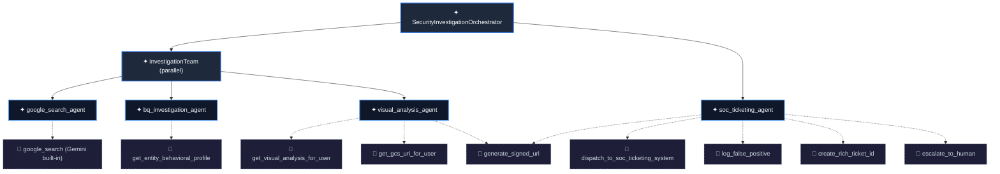

# Architecture

How the platform is put together: what happens between a suspicious log line and a ticket an analyst can act on, which component does each step, and why it is built that way. For how the system got to this shape, see [HISTORY.md](HISTORY.md). For identities, roles and guardrails, see [SECURITY_ARCHITECTURE.md](SECURITY_ARCHITECTURE.md).

Contents:
1. [End-to-end flow](#1-end-to-end-flow)
2. [Ingestion and data engineering](#2-ingestion-and-data-engineering)
3. [Detection](#3-detection)
4. [The multi-agent investigation](#4-the-multi-agent-investigation)
5. [MCP tool service](#5-mcp-tool-service)
6. [SOC ticketing and analyst console](#6-soc-ticketing-and-analyst-console)
7. [Key design decisions](#7-key-design-decisions)
8. [Testing & CI](#8-testing--ci)
9. [Repository layout](#9-repository-layout)

---

## 1. End-to-end flow

https://github.com/user-attachments/assets/b57df497-0734-4f5c-a8de-8aa93e8ef88e


```
                                  ┌───────────────────────────┐
                                  │ Synthetic Log Generator   │
                                  │ CLI & Threat Injection    │
                                  │ event_family: access|net  │
                                  └─────────────┬─────────────┘
                                                │
                                                ▼
                                   ┌─────────────────────────┐
                                   │  Pub/Sub Raw Logs Topic │
                                   │  cymbal_cyber_raw_logs  │
                                   │  (protobuf contract)    │
                                   └───────┬─────────┬───────┘
                                           │         │
                 event_family="access"     │         │ event_family="network"
                 BigQuery Subscription     │         │ BigQuery Subscription
                                           ▼         ▼
                                    BigQuery Tables (Cymbal_Cyber)
                                    ├── user_access_events (DAY partition)
                                    ├── network_events     (DAY partition)
                                    ├── alerts             (DAY partition, clustered)
                                    ├── alerts_dead_letter (DLQ audit store)
                                    ├── adk_threat_assessment
                                    └── soc_tickets        (append-only, partitioned)
                                                 │
                                                 │ Cloud Scheduler (every 5m)
                                                 ▼
                                    ┌─────────────────────────────┐
                                    │ Cloud Run Job: threat-detector
                                    │ (TIMESTAMP_BUCKET 2m + MERGE)
                                    └────────────┬────────────────┘
                                                 │ (Alert Contract JSON)
                                                 ▼
                                    ┌─────────────────────────────┐
                                    │ Topic: cymbal_cyber_alerts  │
                                    └──────┬───────────────┬──────┘
                                           │               │ Failed 5 times
                          Push Subscription│               ▼
                                           │  ┌─────────────────────────────┐
                                           │  │ Topic: cymbal_cyber_alerts_dlq
                                           │  │ Subscription -> DLQ Table   │
                                           │  │ Next detector run escalates │
                                           │  └─────────────────────────────┘
                                           ▼
                                ┌─────────────────────────────────┐
                                │   ADK Multi-Agent Orchestrator  │
                                │   (Cloud Run Webhook: FastAPI)  │
                                └────────────────┬────────────────┘
                                                 │ MCP over HTTPS + ID token
                                                 │ (agent SA: run.invoker only)
                                                 ▼
                                ┌─────────────────────────────────┐
                                │ MCP Tool Service (Cloud Run)    │
                                │ cymbal-cyber-mcp, own SA:       │
                                │ evidence reads, ticket writes   │
                                └────────────────┬────────────────┘
                                                 │
                                                 ▼
                                ┌─────────────────────────────────┐
                                │      SOC Ticketing System       │
                                │  - Incident Queue & BigQuery    │
                                │  - Streamlit Analyst Console    │
                                └─────────────────────────────────┘
```

What runs where in the cloud:

| Component | Google Cloud service | Code |
| :--- | :--- | :--- |
| Telemetry bus | Pub/Sub topics and BigQuery subscriptions | `src/demo/terraform/pubsub.tf` |
| Warehouse and system of record | BigQuery dataset `Cymbal_Cyber` | `src/demo/terraform/bigquery.tf` |
| Threat detector | Cloud Run job `threat-detector`, started by Cloud Scheduler | [`adk_agent/threat_detector.py`](../adk_agent/threat_detector.py) |
| Multi-agent investigator | Cloud Run service `cymbal-cyber-adk-agent` | [`adk_agent/agent.py`](../adk_agent/agent.py), [`adk_agent/guardrails/`](../adk_agent/guardrails/), [`adk_agent/fast_api_app.py`](../adk_agent/fast_api_app.py) |
| Tool service | Cloud Run service `cymbal-cyber-mcp` | [`adk_agent/mcp_server/`](../adk_agent/mcp_server/), [`adk_agent/tools/`](../adk_agent/tools/) |
| Analyst console | Cloud Run service `cymbal-cyber-soc-console` | [`src/demo/soc_ticketing/`](../src/demo/soc_ticketing/) |
| Evidence storage | Cloud Storage (screenshots, escalations, raw logs) | `src/demo/terraform/storage.tf` |
| Models | Gemini through Vertex AI, with retry and a fallback model on 429/5xx ([`model_resilience.py`](../adk_agent/model_resilience.py)) | `GEMINI_MODEL`, default `gemini-3.8-flash`; `GEMINI_FALLBACK_MODEL`, default `gemini-3.7-flash` |

Every service scales to zero. Nothing bills while no telemetry arrives except storage.

---

## 2. Ingestion and data engineering

- **Data contract at the front door.** The raw topic `cymbal_cyber_raw_logs` validates every message against a protobuf schema ([`raw_security_event.proto`](../src/demo/terraform/schemas/raw_security_event.proto)) at publish time. A message with a missing required field, a wrong type or an unknown field is rejected. `test_raw_event_contract.py` keeps the proto, the table schemas and the generator in step.
- **Zero-compute ingestion.** Two Pub/Sub to BigQuery subscriptions, filtered on `attributes.event_family` (`access`, `network`), write straight into `user_access_events` and `network_events` using the table schema (`use_table_schema = true`, `drop_unknown_fields = false`). A write that fails lands in `raw_events_dlq_pull_sub` instead of silently losing columns. No pipeline workers run.
- **Partitioning and clustering.** Event tables and `alerts` are day-partitioned; `alerts` is clustered. Every query the tools run carries a `maximum_bytes_billed` ceiling (1 GB by default).
- **Incidents, not alert storms.** The detector records every qualifying 2-minute window in `alerts`, but publishes only the window that opens an incident (`status = NEW`). Later windows within a 30-minute gap are `CORRELATED` under the same `incident_id`, so one attack runs the agents once. The `incidents` view rolls the windows up.
- **Append-only tickets.** `soc_tickets` is an event log with typed `TIMESTAMP` columns, partitioned by `created_at` and clustered on `status, user_id`. `soc_tickets_current` deduplicates it once (`QUALIFY ROW_NUMBER()`) and adds the classifications the console groups by; the dashboard reads it with one `GROUPING SETS` query. Append-only writes also avoid BigQuery's restriction on updating rows still in the streaming buffer.
- **Unstructured evidence as a table.** Every desktop screenshot is uploaded to a bucket, and `user_screenshots_objects` is a BigLake object table over it, so a new screenshot needs no SQL change.
- **Other loaders.** [`gcs_to_bigquery_loader.py`](../src/demo/data_pipeline/gcs_to_bigquery_loader.py) batch-loads NDJSON files from Cloud Storage. [`pubsub_to_bigquery_dataflow.py`](../src/demo/data_pipeline/pubsub_to_bigquery_dataflow.py) is an optional Apache Beam pipeline kept for comparison (see [HISTORY.md](HISTORY.md#2-a-custom-streaming-pipeline-dataflow)).

The synthetic log generator ([`src/demo/data_generator/`](../src/demo/data_generator/)) produces the telemetry: Pydantic models, a benign baseline, and injectable scenarios (`malicious`: password spraying, a foreign-IP login, C2 DNS beaconing, Mimikatz and PowerShell execution; `false_positive`: admin automation that scores high but is benign; `injection`: a screenshot that tries to instruct the model). It writes to local files, Pub/Sub, BigQuery or Cloud Storage.

---

## 3. Detection

- **Default: scheduled micro-batch.** Cloud Scheduler starts the `threat-detector` Cloud Run job every 5 minutes. It evaluates 2-minute tumbling windows that closed more than 60 seconds ago, scores them with BigQuery UDFs (`calculate_threat_score`, `is_malicious_domain`, `is_malicious_command`), and writes them to `alerts` with an idempotent `MERGE` on `alert_id`, so a rerun never duplicates an alert. Alert latency is about 5 to 7 minutes; continuous cost is zero.
- **Same rules locally.** [`adk_agent/detection_rules.py`](../adk_agent/detection_rules.py) is the Python twin of the UDFs, which is how the local runner scores events without BigQuery.
- **Unified alert contract.** Every engine publishes the same message (`alert_id`, `engine`, `schema_version`, window timestamps, indicator counts) to `cymbal_cyber_alerts`, so the investigator does not care which engine raised the alert. `test_alert_contract.py` holds the shape.
- **Dead letters become tickets.** Pub/Sub retries the push to the agent five times, then routes the alert to `cymbal_cyber_alerts_dlq`, which a BigQuery subscription writes to `alerts_dead_letter`. The next detector run marks it `DEAD_LETTERED` and opens an escalation ticket, so an alert is never silently lost.
- **Optional engines.** A BigQuery continuous query ([`continuous_query.sql`](../src/demo/data_pipeline/continuous_query.sql)) is still available behind `enable_continuous_query`. It gives seconds of latency in exchange for a 24/7 slot reservation; see [CLOUD.md §6](CLOUD.md#6-finops-cost-management--cloud-teardown) for the cost.

---

## 4. The multi-agent investigation

Pub/Sub pushes each alert to the agent's webhook. The orchestrator (`SecurityInvestigationOrchestrator` in [`adk_agent/agent.py`](../adk_agent/agent.py)) marks the alert `INVESTIGATING`, runs the investigation in two phases, and marks it `DONE`:

1. **Parallel investigation.** `InvestigationTeam` runs three specialists at the same time.
2. **Adjudication.** `soc_ticketing_agent` reads their findings and dispatches, escalates or closes the alert.



| Agent | Role | What it does |
| :--- | :--- | :--- |
| `google_search_agent` | External OSINT | Researches the alert's public IPs with Gemini's built-in Google Search grounding (known threat actors, Tor and VPN exit nodes). It only ever sees the public IPs, never the user, device or internal addresses. |
| `bq_investigation_agent` | Behavioral profiling | Builds a 24-hour baseline for the user and device from BigQuery through one fixed, parameterized MCP tool: logins, authentication failures, privilege use, malicious commands and DNS. |
| `visual_analysis_agent` | Desktop forensics | Runs Gemini vision and OCR on the user's desktop screenshot to find malicious utilities (Mimikatz, encoded PowerShell, reverse shells) and prompt-injection text. |
| `soc_ticketing_agent` | Adjudication | Writes a structured Security Incident Report and calls one resolution tool: dispatch an incident ticket, escalate to a human, or close as a false positive. |

The model's choice is checked by deterministic code before it takes effect: the security gate, fail-closed evidence handling and default-deny escalation. They are described in [SECURITY_ARCHITECTURE.md §8](SECURITY_ARCHITECTURE.md#8-agent-guardrails-deterministic-controls-around-the-model).

---

## 5. MCP tool service

Agent tools live in an independent Model Context Protocol server, `cymbal-cyber-mcp` ([`adk_agent/mcp_server/`](../adk_agent/mcp_server/)). The agent chooses the transport from `MCP_SERVER_URL`:

| | Local (`MCP_SERVER_URL` unset) | Cloud (`MCP_SERVER_URL=https://cymbal-cyber-mcp-…/mcp`) |
| :--- | :--- | :--- |
| Transport | `stdio`: one child process per MCP-backed sub-agent | Streamable HTTP (stateless, JSON): the `cymbal-cyber-mcp` Cloud Run service |
| Identity behind the tools | Your ADC / local files | `cymbal-mcp-tools-sa`, its own service account |
| Authentication | None (a child process) | Google ID token minted by the agent SA for the service URL; Cloud Run IAM checks it, then the server re-checks audience and caller |

Why MCP:

- **Privilege boundary, not just a code boundary.** In the cloud the tools run as `cymbal-mcp-tools-sa`, which holds the evidence reads, Gemini vision, signed URLs and ticket writes. The agent's own identity holds none of these; its only grant on the tool service is `roles/run.invoker`. A prompt-injected agent can only ask for the fixed operations below.
- **Process isolation.** Database SDKs, image processing and network clients run outside the orchestrator, so a crash or leak there cannot take the orchestrator down.
- **Least-privilege tool scoping.** Each sub-agent connects through a `ScopedMcpToolset` whose `tool_filter` lists only its tools. The BigQuery agent cannot sign URLs; the vision agent cannot touch tickets.
- **No free-form SQL.** There is no `execute_sql` or schema-discovery tool, so even a client that connects without a filter cannot run arbitrary queries.
- **Interoperability.** Because it speaks standard MCP, other clients (Gemini Enterprise, Cursor, Claude Desktop) can use the same tool catalog over `stdio`. The deployed service admits only the agent's identity.

Registered tools (8 agent tools and 1 platform tool):

| Domain | Tool | Purpose |
| :--- | :--- | :--- |
| **BigQuery telemetry** | `get_entity_behavioral_profile` | 24-hour behavioral baseline for a user or IP. |
| **Multimodal vision** | `get_visual_analysis_for_user` | Gemini OCR and inspection of desktop screenshot evidence. |
| | `get_gcs_uri_for_user` | Resolves the `gs://` URI of a user's desktop capture. |
| | `generate_signed_url` | Short-lived V4 signed URL for analyst viewing, limited to the screenshots bucket. |
| **SOC operations** | `dispatch_to_soc_ticketing_system` | Writes a high-confidence incident to `soc_tickets`. |
| | `log_false_positive` | Closes benign activity and archives it ("Auto-closed by agent") for analyst review. |
| | `create_rich_ticket_id` | Generates a ticket ID; during an investigation the gate replaces it with the alert's deterministic ID. |
| | `escalate_to_human` | Writes the forensic payload to Cloud Storage for senior analyst review. |
| **Platform only** | `auto_escalate_unresolved_alert` | Default-deny escalation when the model resolves nothing. No agent's filter lists it, so no model is offered it. |

---

## 6. SOC ticketing and analyst console

- **Ticketing service** ([`ticketing_service.py`](../src/demo/soc_ticketing/ticketing_service.py), parts in [`service/`](../src/demo/soc_ticketing/service/)): ticket creation, BigQuery storage (`soc_tickets`, `adk_threat_assessment`), the Cloud Storage escalation queue, and fail-closed writes (a failed write is an error, never a silent success).
- **Analyst console** ([`streamlit_soc_console.py`](../src/demo/soc_ticketing/streamlit_soc_console.py), pages in [`console/`](../src/demo/soc_ticketing/console/)): a Streamlit app with a live triage queue, a ticket dossier (agent findings, screenshot evidence through signed URLs, recommendations), an archive of auto-closed false positives, KPI dashboards, and an "Ask the Agent" assistant for questions about a ticket.
- **Demo controls** ([`demo_actions.py`](../src/demo/soc_ticketing/demo_actions.py)): "Inject scenario" and "Stream logs" publish to the raw topic as the console's own service account, so injected events take the real path (subscription, detector, agent). A scripted ticket marked **Simulated** is added so there is something to triage immediately; it is badged and excluded from every metric.

---

## 7. Key design decisions

| Decision | Alternative considered | Why | Trade-off |
| :--- | :--- | :--- | :--- |
| Scheduled micro-batch detector | BigQuery continuous query, Dataflow streaming | Zero continuous cost instead of ~$4,300 or ~$100-300 a month | 5 to 7 minutes of alert latency |
| Reasoning in ADK agents | Gemini called inside SQL (`ML.GENERATE_TEXT`) | Multi-step reasoning, error handling and guardrails need real code | One more service to run |
| Agent on Cloud Run | Vertex AI Agent Engine | Native Pub/Sub OIDC push and full control of FastAPI routes | We operate the container ourselves |
| Tools behind MCP, as their own service | Python tools inside the agent | The agent's identity cannot read evidence or write tickets | A network hop and an ID token per session |
| BigQuery as system of record | A separate ticket database | Agents, detector and console share one auditable dataset | Append-only modelling to work with the streaming buffer |
| Deterministic guardrails around the model | Prompt instructions alone | A prompt is not a control; code is | More callbacks to maintain and test |

Each of these is told as a story, with what remains of the alternatives in the repo, in [HISTORY.md](HISTORY.md).

---

## 8. Testing & CI

| Layer | Where | What it proves | Needs cloud |
| :--- | :--- | :--- | :--- |
| Unit | `src/demo/tests/unit/` | Tools, MCP server and transport, security gate, privacy guard, detection rules, alert and raw-event contracts, webhook surface, console | No |
| End-to-end | `src/demo/tests/e2e/` | The real orchestrator, MCP servers and security gate on all three scenarios, with a scripted model | No |
| Integration | `src/demo/tests/integration/` | The agent and server against real Google Cloud services | Yes |
| Agent evaluation | `src/demo/tests/eval/` | Tool-trajectory and response-quality datasets for `agents-cli eval` | Gemini |

The [CI workflow](../.github/workflows/ci.yml) runs on pushes and pull requests to `main`: Ruff, the unit tests and the end-to-end test with `LOCAL_MODE=true`, plus Terraform format, validation and Checkov static security analysis on `src/demo/terraform`.

---

## 9. Repository layout

```text
.
├── adk_agent/                      # ADK multi-agent package (agents-cli agent_directory)
│   ├── agent.py                    # Composition root: orchestrator, investigation team, 4 sub-agents
│   ├── guardrails/                 # Security gate, fail-closed evidence state, search privacy, lifecycle
│   ├── prompts.py                  # Sub-agent instructions
│   ├── mcp_client.py               # Scoped MCP toolsets, stdio or HTTP with an ID token
│   ├── settings.py                 # Project, dataset and model settings shared by agent and tools
│   ├── tools/                      # Tool implementations behind the MCP server, one module per data source
│   ├── privacy_guard.py            # Public-IP extraction, search audit rules, PII masking
│   ├── mcp_server/                 # MCP tool server ("cymbal-cyber-mcp"): stdio or HTTP
│   ├── threat_detector.py          # Scheduled micro-batch detector (Cloud Run job)
│   ├── detection_rules.py          # Python twin of the BigQuery detection UDFs
│   ├── fast_api_app.py             # FastAPI backend (Pub/Sub webhook)
│   └── app_utils/                  # Webhook, OIDC check, Pub/Sub parsing, dedup, alert status, A2A
├── src/demo/
│   ├── data_generator/             # Synthetic log generator and threat scenarios
│   ├── data_pipeline/              # Continuous query, Dataflow and GCS loader (optional paths)
│   ├── scripts/                    # pre_flight.sh, deploy_cloud.sh and optional-engine launchers
│   ├── soc_ticketing/              # Ticketing service and Streamlit analyst console
│   ├── terraform/                  # All Google Cloud infrastructure
│   ├── tests/                      # unit/, e2e/, integration/ and eval/
│   ├── local_runner.py             # Zero-cloud runner: real agents, scripted or live model
│   └── scripted_model.py           # Deterministic stand-in for Gemini in local runs and tests
├── local_demo_data/                # Desktop screenshots and the local ticket queue
├── docs/                           # This documentation
├── .github/workflows/ci.yml        # CI
├── Dockerfile                      # One image for every Cloud Run service and the job
├── GEMINI.md                       # Guide for coding agents working in this repo
└── README.md
```
