# Real-Time Cybersecurity AI: Cloud Architecture, Data Engineering, ADK & SOC

This demonstration showcases an enterprise-grade cybersecurity threat detection, autonomous multi-agent AI forensic investigation, and human-in-the-loop Security Operations Center (SOC) response platform built on Google Cloud Platform (configured for project `<PROJECT_ID>`).

It seamlessly bridges **Cloud Architecture**, **Stream Data Engineering**, **Agentic Multi-Agent AI**, and **SOC Operations**:
- **Synthetic Log Generator:** Modular Python tool generating access and network logs with ad-hoc threat injection (both APT attacks and administrative false positives).
- **Data Ingestion Pipelines:** Multiple ingestion pathways to BigQuery via Cloud Storage batch loads, Pub/Sub to Dataflow streaming, or direct BigQuery streaming.
- **BigQuery Continuous Queries:** Stateful stream processing performing temporal windowed joins between login events and network activity.
- **BigQuery Threat Scanner:** Active background daemon monitoring BigQuery for newly emerging threat events.
- **Google ADK Multi-Agent Team:** Autonomous orchestrator coordinating 4 specialized agents:
  1. `google_search_agent`: OSINT threat intel on external public IPs via Google Search.
  2. `bq_investigation_agent`: 24-hour behavioral profile queries in BigQuery using parameterized SQL.
  3. `visual_analysis_agent`: Gemini multimodal vision OCR inspecting user desktop forensic screenshots.
  4. `soc_ticketing_agent`: Consolidates forensic findings, generates structured reports, and dispatches incident tickets.
- **SOC Ticketing System & Analyst Console:** Persistent incident queue and interactive Streamlit console for analyst triage.
- **Terraform Infrastructure as Code:** Modular IaC templates provisioning BigQuery datasets, tables, Pub/Sub topics, subscriptions, and GCS buckets.
- **Zero-Cloud Local Runner:** Complete end-to-end pipeline simulation locally with zero cloud deployment required.

---

## 🏛️ System Architecture


```
                                  ┌───────────────────────────┐
                                  │ Synthetic Log Generator   │
                                  │ CLI & Threat Injection    │
                                  └─────────────┬─────────────┘
                                                │
                 ┌──────────────────────────────┼──────────────────────────────┐
                 ▼                              ▼                              ▼
    ┌─────────────────────────┐   ┌─────────────────────────┐   ┌─────────────────────────┐
    │  Google Cloud Storage   │   │     Cloud Pub/Sub       │   │  Direct BQ Streaming    │
    │  gs://cymbal-cyber-     │   │  cymbal_cyber_raw_logs  │   │     Storage Write API   │
    │  raw-logs_<PROJECT_ID>  │   └─────────────┬───────────┘   └─────────────┬───────────┘
    └────────────┬────────────┘                 │                             │
                 │ (GCS Loader)                 │ (Dataflow Streaming)        │
                 └──────────────────────┐       ▼                             │
                                        ▼─────────────────────────────────────┘
                                   BigQuery Tables (Cymbal_Cyber)
                                   ├── user_access_events
                                   ├── network_events
                                   ├── adk_threat_assessment
                                   └── soc_tickets
                                                │
                         ┌──────────────────────┴──────────────────────┐
                         ▼                                             ▼
            BigQuery Continuous Query                      BigQuery Threat Scanner
            (Exports alerts >= 100 to Pub/Sub)             (Active daemon reading BQ)
                         │                                             │
                         └──────────────────────┬──────────────────────┘
                                                ▼
                               ┌─────────────────────────────────┐
                               │   ADK Multi-Agent Orchestrator  │
                               │           (adk_agent/)          │
                               └────────────────┬────────────────┘
                                                │
         ┌──────────────────────────────┬───────┴──────────────────────┬──────────────────────────────┐
         ▼                              ▼                              ▼                              ▼
┌──────────────────┐           ┌──────────────────┐           ┌──────────────────┐           ┌──────────────────┐
│google_search_    │           │bq_investigation_ │           │visual_analysis_  │           │soc_ticketing_    │
│agent             │           │agent             │           │agent             │           │agent             │
│                  │           │                  │           │                  │           │                  │
│Tool:             │           │Tools:            │           │Tools:            │           │Tools:            │
│google_search     │           │BigQueryToolset,  │           │Vision OCR,       │           │Dispatch Ticket,  │
│(OSINT IP Lookup) │           │behavioral queries│           │Signed GCS URL    │           │False Positive BQ │
└──────────────────┘           └──────────────────┘           └──────────────────┘           └─────────┬────────┘
                                                                                                       │
                                                                                                       ▼
                                                                                      ┌─────────────────────────────────┐
                                                                                      │      SOC Ticketing System       │
                                                                                      │  - Incident Queue & BigQuery    │
                                                                                      │  - Webhook Dispatcher           │
                                                                                      │  - Streamlit Analyst Console    │
                                                                                      └─────────────────────────────────┘
```

---

## ⚡ Quickstart: Local Testing (Zero Cloud Required)

You can run the entire pipeline locally without deploying any GCP resources or incurring cloud costs.

### 1. Run the End-to-End Local Pipeline
```bash
# Test Scenario A: Malicious APT attack (User: u.lewis, Lazarus Group IP, Mimikatz)
python -m src.demo.local_runner --threat malicious

# Test Scenario B: Benign False Positive (User: l.taylor, Admin backup script)
python -m src.demo.local_runner --threat false_positive
```

### 2. Launch the Local SOC Analyst Console
```bash
LOCAL_MODE=true streamlit run src/demo/soc_ticketing/streamlit_soc_console.py
```
Open `http://localhost:8501` to view the incident queue, inspect desktop screenshot evidence (`u.lewis.png`), review the ADK report, and adjudicate the incident.

### 3. Run Automated Tests
```bash
uv run pytest src/demo/tests/ tests/unit/
```

---

## ⚙️ Component Details

### 1. Synthetic Log Generator & Threat Injection (`src/demo/data_generator/`)
Modular CLI tool and Python API generating high-fidelity security logs:
- **Models:** Validated Pydantic models in [`data_generator/models.py`](data_generator/models.py).
- **Threat Scenarios:** Pre-configured scenarios in [`data_generator/threat_scenarios.py`](data_generator/threat_scenarios.py):
  - `malicious`: Password spraying, foreign IP breach (North Korea / Russia), C2 DNS beaconing, mimikatz/powershell execution, and payload downloads.
  - `false_positive`: Administrative automation noise (curl, ping, ipconfig, batch backup) triggering scores without malicious compromise.
- **Sinks:** Write logs to Cloud Storage, Cloud Pub/Sub, direct BigQuery, or local files in [`data_generator/sinks.py`](data_generator/sinks.py).

```bash
# Generate batch benign logs locally:
python -m src.demo.data_generator.log_generator --mode benign --batch-size 100 --destination local

# Stream benign logs directly to BigQuery:
python -m src.demo.data_generator.log_generator --mode continuous --rate 50 --destination bigquery

# Upload batch logs to Cloud Storage:
python -m src.demo.data_generator.log_generator --mode benign --batch-size 250 --destination gcs --bucket cymbal-cyber-raw-logs_<PROJECT_ID>

# Inject ad-hoc MALICIOUS threat scenario:
python -m src.demo.data_generator.log_generator --mode threat --threat-type malicious --user u.lewis --destination bigquery

# Inject ad-hoc FALSE POSITIVE threat scenario:
python -m src.demo.data_generator.log_generator --mode threat --threat-type false_positive --user l.taylor --destination bigquery
```

---

### 2. Data Pipelines to BigQuery (`src/demo/data_pipeline/`)
- **Pub/Sub to BigQuery Dataflow Streaming Pipeline:** [`data_pipeline/pubsub_to_bigquery_dataflow.py`](data_pipeline/pubsub_to_bigquery_dataflow.py)
  Apache Beam pipeline streaming from `cymbal_cyber_raw_logs` into BigQuery tables.
- **GCS to BigQuery Batch Loader:** [`data_pipeline/gcs_to_bigquery_loader.py`](data_pipeline/gcs_to_bigquery_loader.py)
  Loads NDJSON log files from Cloud Storage into partitioned/clustered tables.
- **BigQuery Continuous Query:** [`data_pipeline/continuous_query.sql`](data_pipeline/continuous_query.sql)
  Continuous stream query running temporal joins and aggregating 2-minute tumbling windows into `cymbal_cyber_alerts`.

---

### 3. Google ADK Multi-Agent Architecture (`adk_agent/`)

```mermaid
graph TD
    classDef orchestrator fill:#1e293b,stroke:#3b82f6,stroke-width:2px,color:#f8fafc;
    classDef agent fill:#0f172a,stroke:#60a5fa,stroke-width:2px,color:#f8fafc;
    classDef tool fill:#1e1e38,stroke:#94a3b8,stroke-dasharray: 4 4,stroke-width:1px,color:#cbd5e1;

    Orchestrator["✦ SecurityInvestigationOrchestrator"]:::orchestrator
    Team["✦ InvestigationTeam (ParallelOrchestrator)"]:::orchestrator
    TicketingAgent["✦ soc_ticketing_agent"]:::agent

    SearchAgent["✦ google_search_agent"]:::agent
    BQAgent["✦ bq_investigation_agent"]:::agent
    VisualAgent["✦ visual_analysis_agent"]:::agent

    ToolSearch["🔧 google_search"]:::tool
    ToolBQQuery["🔧 build_event_logs_query"]:::tool
    ToolBQSet["🔧 BigQueryToolset"]:::tool
    ToolVisAnalysis["🔧 get_visual_analysis_for_user"]:::tool
    ToolGCSUri["🔧 get_gcs_uri_for_user"]:::tool
    ToolSignedUrl["🔧 generate_signed_url"]:::tool

    ToolDispatch["🔧 dispatch_to_soc_ticketing_system"]:::tool
    ToolFP["🔧 log_false_positive"]:::tool
    ToolTicketId["🔧 create_rich_ticket_id"]:::tool
    ToolEscalate["🔧 escalate_to_human"]:::tool

    Orchestrator --> Team
    Orchestrator --> TicketingAgent

    Team --> SearchAgent
    Team --> BQAgent
    Team --> VisualAgent

    SearchAgent -.-> ToolSearch
    BQAgent -.-> ToolBQQuery
    BQAgent -.-> ToolBQSet
    VisualAgent -.-> ToolVisAnalysis
    VisualAgent -.-> ToolGCSUri
    VisualAgent -.-> ToolSignedUrl

    TicketingAgent -.-> ToolSignedUrl
    TicketingAgent -.-> ToolDispatch
    TicketingAgent -.-> ToolFP
    TicketingAgent -.-> ToolTicketId
    TicketingAgent -.-> ToolEscalate
```



- **Orchestrator (`SecurityInvestigationOrchestrator`):**
  Coordinates parallel intelligence gathering from Google Search, BigQuery, and visual forensics before passing to the ticketing agent.
- **Sub-Agents & Tools:**
  1. **`google_search_agent`**
     - **Description:** *"Agent that researches IP addresses from security alerts."*
     - **Tool:** `google_search`
     - **Purpose:** Extracts public IPs and researches origin country, ASN, reputation, and threat intel.
  2. **`bq_investigation_agent`**
     - **Description:** *"Agent that answers questions about BigQuery data by executing SQL queries."*
     - **Tools:** `build_event_logs_query`, `BigQueryToolset`
     - **Purpose:** Constructs and executes 24-hour parameterized behavioral queries against BigQuery dataset `Cymbal_Cyber`.
  3. **`visual_analysis_agent`**
     - **Description:** *"Agent that analyzes user desktop screenshots using multi-modal AI to uncover forensic visual evidence."*
     - **Tools:** `get_visual_analysis_for_user`, `get_gcs_uri_for_user`, `generate_signed_url`
     - **Purpose:** Multimodal Gemini vision OCR on user desktop screenshots and signed URL generation.
  4. **`soc_ticketing_agent`**
     - **Description:** *"Agent that consolidates findings, decides on best action to take, and passes tickets to the SOC ticketing system."*
     - **Tools:** `dispatch_to_soc_ticketing_system`, `log_false_positive`, `create_rich_ticket_id`, `escalate_to_human`, `generate_signed_url`
     - **Purpose:** Generates comprehensive Security Incident Report and passes tickets to the SOC ticketing system.

---

### 4. BigQuery Threat Scanner Service (`adk_agent/threat_scanner.py`)
Monitors BigQuery for correlated anomalies and triggers the multi-agent investigation:
```bash
# Single scan:
python -m adk_agent.threat_scanner --once

# Continuous daemon:
python -m adk_agent.threat_scanner --daemon --interval 30
```

---

### 5. SOC Ticketing System & Console (`src/demo/soc_ticketing/`)
- **Service Backend:** [`soc_ticketing/ticketing_service.py`](soc_ticketing/ticketing_service.py) handles ticket creation, BigQuery storage (`soc_tickets`, `adk_threat_assessment`), GCS queue management, and outbound webhooks.
- **Streamlit Analyst Console:** [`soc_ticketing/streamlit_soc_console.py`](soc_ticketing/streamlit_soc_console.py) provides a web UI for human analysts to review and adjudicate tickets.

---

### 6. Cloud Deployment with Terraform (`src/demo/terraform/`)
Full Google Cloud infrastructure provisioning under project `<PROJECT_ID>`:

```bash
cd src/demo/terraform
terraform init
terraform plan -var="project_id=<PROJECT_ID>"
terraform apply -var="project_id=<PROJECT_ID>" -auto-approve
```

**Resources provisioned:**
- **APIs:** BigQuery, Vertex AI, Pub/Sub, Storage, Dataflow, IAM Credentials, Resource Manager.
- **IAM:** Service Account `bq-continuous-query-sa` with least-privilege roles and self-token-creation.
- **Storage:** 4 GCS Buckets (staging, escalations, screenshots, raw_logs) configured with `public_access_prevention = "enforced"`.
- **BigQuery:** Dataset `Cymbal_Cyber` with `delete_contents_on_destroy = true`, partitioned & clustered tables, routing UDFs, and connection `continuous-query-vertex-ai-connection`.
- **Pub/Sub:** Topics `cymbal_cyber_alerts` and `cymbal_cyber_raw_logs` with subscriptions and OIDC push configurations.

---

### 7. FinOps: Cost Control & Teardown

**⚠️ Running Costs Warning:**
While the local Python runner is free, deploying the live infrastructure via Terraform incurs **continuous running costs**:
- **BigQuery Continuous Queries:** Require a BigQuery Enterprise Edition reservation, which bills for active slots 24/7 while the query runs.
- **Dataflow Streaming:** The `pubsub_to_bigquery` streaming ingestion job provisions continuous compute resources.
- **Cloud Run & Vertex AI:** Billed per request / execution duration.

**Budget Alerts:**
You can optionally deploy a $100 budget alert by passing your Billing Account ID during `terraform apply`:
```bash
terraform apply -var="project_id=<PROJECT_ID>" -var="billing_account_id=<YOUR_BILLING_ACCOUNT_ID>"
```

**Clean Teardown:**
To stop continuous billing, cleanly destroy the infrastructure when you are finished testing:
```bash
terraform destroy -var="project_id=<PROJECT_ID>"
```
*(Note: BigQuery datasets and GCS buckets are configured with `force_destroy` and `delete_contents_on_destroy` so teardown succeeds even if populated).*

---

### 8. Unit Tests & Verification
Run the automated test suite with `uv`:
```bash
uv run pytest src/demo/tests/ tests/unit/
```
Validates models, agent configurations, security DML guards, SQL parameterization, signed URL generation, threat generators, and ticketing operations.
