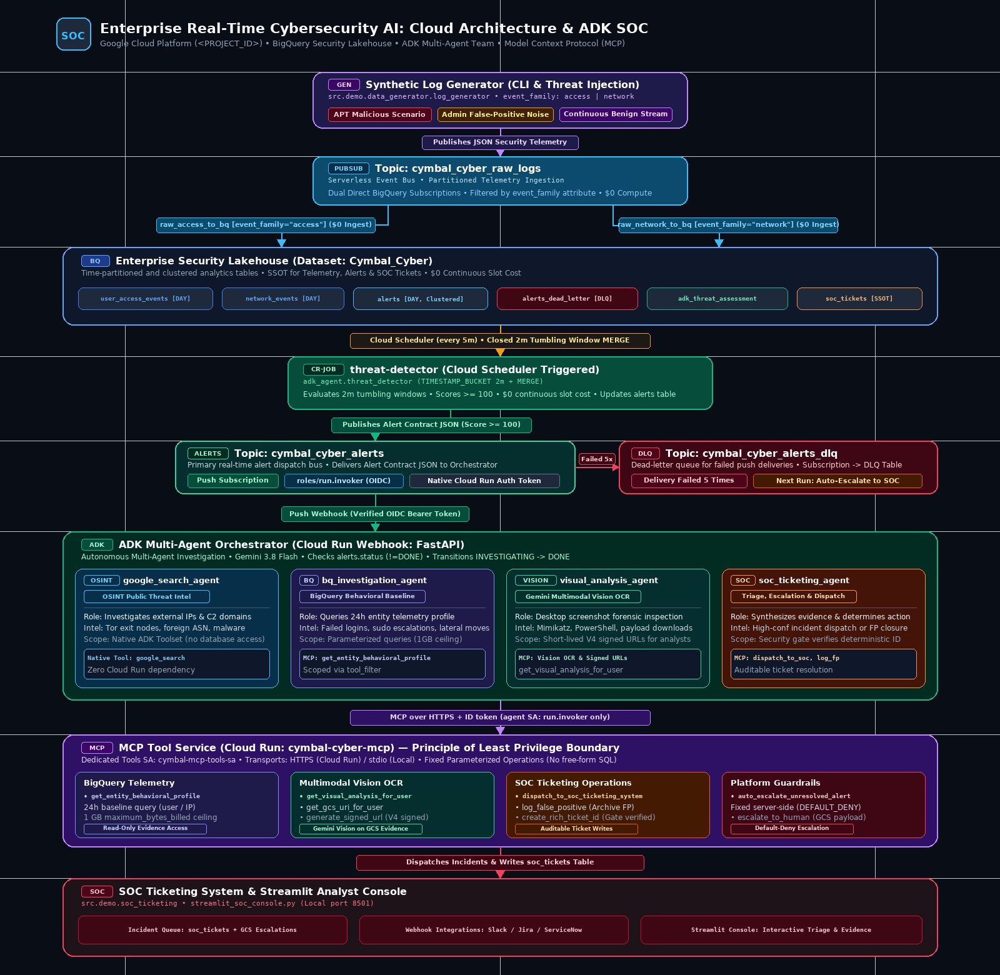

# Real-Time Cybersecurity AI: Cloud Architecture, Data Engineering, ADK & SOC

This demonstration showcases a reference demo with production-style patterns for real-time cybersecurity threat detection, autonomous multi-agent AI forensic investigation, and human-in-the-loop Security Operations Center (SOC) response built on Google Cloud Platform (configured for project `<PROJECT_ID>`).

It seamlessly bridges **Cloud Architecture**, **Stream Data Engineering**, **Agentic Multi-Agent AI**, and **SOC Operations**:
- **Synthetic Log Generator:** Modular Python tool generating access and network logs with ad-hoc threat injection (both APT attacks and administrative false positives).
- **Zero-Cost Direct Ingestion:** Pub/Sub to BigQuery subscriptions using direct table schemas (`use_table_schema=true`, `drop_unknown_fields=true`) filtered by `attributes.event_family` (`access` and `network`), replacing expensive always-on Dataflow VMs.
- **Budget-Optimized Detection Engine:** A scheduled micro-batch Cloud Run Job (`threat-detector`) running every 5 minutes via Cloud Scheduler, evaluating 2-minute tumbling windows closed >60s ago and idempotently executing `MERGE` on `alert_id`. Cuts always-on cost from ~$4,300/month to near zero (alert latency ~5 to 7 minutes with late-data allowance).
- **Optional Continuous Query & Dataflow Engines:** Continuous queries (with BigQuery reservations) and Dataflow streaming pipelines remain available as optional, on-demand toggles for high-throughput live demos.
- **Unified Alert Contract:** All detection engines publish identical contract messages (`alert_id`, `engine`, `schema_version`, window timestamps, indicator counts) to topic `cymbal_cyber_alerts`.
- **Dead-Letter Auto-Escalation:** Alerts failing 5 webhook delivery attempts are routed to `cymbal_cyber_alerts_dlq`, logged to BigQuery `alerts_dead_letter`, and auto-escalated to SOC tickets.
- **Google ADK Multi-Agent Team:** Autonomous orchestrator coordinating 4 specialized agents:
  1. `google_search_agent`: OSINT threat intel on external public IPs via Google Search.
  2. `bq_investigation_agent`: 24-hour behavioral profile queries in BigQuery using parameterized SQL.
  3. `visual_analysis_agent`: Gemini multimodal vision OCR inspecting user desktop forensic screenshots.
  4. `soc_ticketing_agent`: Consolidates forensic findings, generates structured reports, and dispatches incident tickets.
- **SOC Ticketing System & Analyst Console:** Persistent incident queue and interactive Streamlit console for analyst triage.
- **Terraform Infrastructure as Code:** Modular IaC templates provisioning BigQuery datasets, tables, Pub/Sub topics, subscriptions, and GCS buckets.
- **Zero-Cloud Local Runner:** Complete end-to-end pipeline simulation locally with zero cloud deployment required.

---

## 🏛️ System Architecture



```
                                  ┌───────────────────────────┐
                                  │ Synthetic Log Generator   │
                                  │ CLI & Threat Injection    │
                                  │ event_family: access|net  │
                                  └─────────────┬─────────────┘
                                                │
                                                ▼
                                   ┌─────────────────────────┐
                                   │  Pub/Sub Raw Logs Topic │
                                   │  cymbal_cyber_raw_logs  │
                                   └───────┬─────────┬───────┘
                                           │         │
                 event_family="access"     │         │ event_family="network"
                 BigQuery Subscription     │         │ BigQuery Subscription
                                           ▼         ▼
                                    BigQuery Tables (Cymbal_Cyber)
                                    ├── user_access_events (DAY partition)
                                    ├── network_events     (DAY partition)
                                    ├── alerts             (DAY partition, clustered)
                                    ├── alerts_dead_letter (DLQ audit store)
                                    ├── adk_threat_assessment
                                    └── soc_tickets
                                                 │
                                                 │ Cloud Scheduler (every 5m)
                                                 ▼
                                    ┌─────────────────────────────┐
                                    │ Cloud Run Job: threat-detector
                                    │ (TIMESTAMP_BUCKET 2m + MERGE)
                                    └────────────┬────────────────┘
                                                 │ (Alert Contract JSON)
                                                 ▼
                                    ┌─────────────────────────────┐
                                    │ Topic: cymbal_cyber_alerts  │
                                    └──────┬───────────────┬──────┘
                                           │               │ Failed 5 times
                          Push Subscription│               ▼
                                           │  ┌─────────────────────────────┐
                                           │  │ Topic: cymbal_cyber_alerts_dlq
                                           │  │ Subscription -> DLQ Table   │
                                           │  └────────────┬────────────────┘
                                           │               ▼
                                           │  ┌─────────────────────────────┐
                                           │  │ Detector Next Run: Marks    │
                                           │  │ DEAD_LETTERED & Auto-Escalate
                                           │  └─────────────────────────────┘
                                           ▼
                                ┌─────────────────────────────────┐
                                │   ADK Multi-Agent Orchestrator  │
                                │   (Cloud Run Webhook: Fast API) │
                                │   - Checks alerts.status (!=DONE)
                                │   - Sets INVESTIGATING -> DONE   │
                                └────────────────┬────────────────┘
                                                 │
         ┌──────────────────────────────┬────────┴──────────────────────┬──────────────────────────────┐
         ▼                              ▼                               ▼                              ▼
┌──────────────────┐           ┌──────────────────┐           ┌──────────────────┐           ┌──────────────────┐
│google_search_    │           │bq_investigation_ │           │visual_analysis_  │           │soc_ticketing_    │
│agent             │           │agent             │           │agent             │           │agent             │
│                  │           │                  │           │                  │           │                  │
│Tool:             │           │Tools:            │           │Tools:            │           │Tools:            │
│google_search     │           │BigQueryToolset,  │           │Vision OCR,       │           │Dispatch Ticket,  │
│(OSINT IP Lookup) │           │behavioral queries│           │Signed GCS URL    │           │False Positive BQ │
└──────────────────┘           └──────────────────┘           └──────────────────┘           └─────────┬────────┘
                                                                                                       │
                                                                                                       ▼
                                                                                      ┌─────────────────────────────────┐
                                                                                      │      SOC Ticketing System       │
                                                                                      │  - Incident Queue & BigQuery    │
                                                                                      │  - Webhook Dispatcher           │
                                                                                      │  - Streamlit Analyst Console    │
                                                                                      └─────────────────────────────────┘
```

---

## ⚡ Quickstart: Local Testing (Zero Cloud Required)

You can run the entire pipeline locally without deploying any GCP resources or incurring cloud costs.

### 1. Run the End-to-End Local Pipeline
```bash
# Test Scenario A: Malicious APT attack (User: u.lewis, Lazarus Group IP, Mimikatz)
python -m src.demo.local_runner --threat malicious

# Test Scenario B: Benign False Positive (User: l.taylor, Admin backup script)
python -m src.demo.local_runner --threat false_positive
```

### 2. Launch the Local SOC Analyst Console
```bash
LOCAL_MODE=true streamlit run src/demo/soc_ticketing/streamlit_soc_console.py
```
Open `http://localhost:8501` to view the incident queue, inspect desktop screenshot evidence (`u.lewis.png`), review the ADK report, and adjudicate the incident.

### 3. Run Automated Tests
```bash
uv run pytest src/demo/tests/unit/
```

---

## ⚙️ Component Details

### 1. Synthetic Log Generator & Threat Injection (`src/demo/data_generator/`)
Modular CLI tool and Python API generating high-fidelity security logs:
- **Models:** Validated Pydantic models in [`data_generator/models.py`](data_generator/models.py).
- **Threat Scenarios:** Pre-configured scenarios in [`data_generator/threat_scenarios.py`](data_generator/threat_scenarios.py):
  - `malicious`: Password spraying, foreign IP breach (North Korea / Russia), C2 DNS beaconing, mimikatz/powershell execution, and payload downloads.
  - `false_positive`: Administrative automation noise (curl, ping, ipconfig, batch backup) triggering scores without malicious compromise.
- **Sinks:** Write logs to Cloud Storage, Cloud Pub/Sub, direct BigQuery, or local files in [`data_generator/sinks.py`](data_generator/sinks.py).

```bash
# Note: Streaming to cloud sinks (pubsub, bigquery, gcs) requires local Application Default Credentials:
# gcloud auth application-default login

# Generate batch benign logs locally:
PYTHONPATH=src uv run python -m demo.data_generator.log_generator --mode benign --batch-size 100 --sink=local

# Stream benign logs directly to BigQuery (requires ADC):
PYTHONPATH=src uv run python -m demo.data_generator.log_generator --mode continuous --rate 50 --sink=bigquery

# Upload batch logs to Cloud Storage (requires ADC):
PYTHONPATH=src uv run python -m demo.data_generator.log_generator --mode benign --batch-size 250 --sink=gcs --bucket cymbal-cyber-raw-logs_<PROJECT_ID>

# Inject ad-hoc MALICIOUS threat scenario directly to BigQuery:
PYTHONPATH=src uv run python -m demo.data_generator.log_generator --mode threat --threat-type malicious --user u.lewis --sink=bigquery

# Or publish to Pub/Sub (requires ADC; allow 60s for BigQuery Storage Write API buffer ingestion before detection):
PYTHONPATH=src uv run python -m demo.data_generator.log_generator --mode threat --threat-type malicious --user u.lewis --sink=pubsub
echo "Allowing 60s for BigQuery streaming buffer ingestion..." && sleep 60
uv run python -m adk_agent.threat_detector --lookback 15 --min-score 100

# Inject ad-hoc FALSE POSITIVE threat scenario:
PYTHONPATH=src uv run python -m demo.data_generator.log_generator --mode threat --threat-type false_positive --user l.taylor --sink=bigquery
```

---

### 2. Data Pipelines to BigQuery (`src/demo/data_pipeline/`)
- **Pub/Sub to BigQuery Direct Subscriptions [Default]:** Direct table ingestion configured in Terraform (`raw_access_to_bq` & `raw_network_to_bq`) using table schemas (`use_table_schema = true`, `drop_unknown_fields = true`) and filtered by `attributes.event_family` (`access` and `network`). Provides serverless, zero-compute-cost streaming ingestion directly into `user_access_events` and `network_events`.
- **Scheduled Threat Detector (Cloud Run Job) [Default]:** [`adk_agent/threat_detector.py`](/workspaces/Google/adk_agent/threat_detector.py)
  Scheduled micro-batch detector triggered every 5 minutes by Cloud Scheduler. Evaluates 2-minute tumbling windows closed >60s ago via idempotent BigQuery `MERGE`, publishing alert contract JSON to Pub/Sub with $0 continuous slot reservation cost (alert latency ~5 to 7 minutes with late-data allowance).
- **Pub/Sub to BigQuery Dataflow Streaming Pipeline [Optional / Benchmark Only]:** [`data_pipeline/pubsub_to_bigquery_dataflow.py`](data_pipeline/pubsub_to_bigquery_dataflow.py)
  Apache Beam pipeline streaming from `cymbal_cyber_raw_logs` into BigQuery tables. Optional custom ETL alternative; gated off by default to avoid streaming VM charges. (Do not run concurrently with direct subscriptions to prevent duplicate rows).
- **BigQuery Continuous Query [Optional / Benchmark Only]:** [`data_pipeline/continuous_query.sql`](data_pipeline/continuous_query.sql)
  Continuous stream query running temporal joins and aggregating 2-minute tumbling windows into `cymbal_cyber_alerts`. Requires 100 Enterprise Edition reservation slots.
- **GCS to BigQuery Batch Loader:** [`data_pipeline/gcs_to_bigquery_loader.py`](data_pipeline/gcs_to_bigquery_loader.py)
  Loads NDJSON log files from Cloud Storage into partitioned/clustered tables.
- **Operational & Demo Scripts (`src/demo/scripts/`):**
  - [`scripts/deploy_cloud.sh`](scripts/deploy_cloud.sh): Builds unified container image and deploys Cloud Run Service & Job.
  - [`scripts/launch_continuous_query.sh`](scripts/launch_continuous_query.sh): Submits continuous query with Enterprise slots.
  - [`scripts/run_dataflow_demo.sh`](scripts/run_dataflow_demo.sh): Submits optional Apache Beam Dataflow streaming pipeline.

---

### 3. Google ADK Multi-Agent Architecture (`adk_agent/`)

```mermaid
graph TD
    classDef orchestrator fill:#1e293b,stroke:#3b82f6,stroke-width:2px,color:#f8fafc;
    classDef agent fill:#0f172a,stroke:#60a5fa,stroke-width:2px,color:#f8fafc;
    classDef tool fill:#1e1e38,stroke:#94a3b8,stroke-dasharray: 4 4,stroke-width:1px,color:#cbd5e1;

    Orchestrator["✦ SecurityInvestigationOrchestrator"]:::orchestrator
    Team["✦ InvestigationTeam (ParallelOrchestrator)"]:::orchestrator
    TicketingAgent["✦ soc_ticketing_agent"]:::agent

    SearchAgent["✦ google_search_agent"]:::agent
    BQAgent["✦ bq_investigation_agent"]:::agent
    VisualAgent["✦ visual_analysis_agent"]:::agent

    ToolSearch["🔧 google_search"]:::tool
    ToolBQQuery["🔧 build_event_logs_query"]:::tool
    ToolBQSet["🔧 BigQueryToolset"]:::tool
    ToolVisAnalysis["🔧 get_visual_analysis_for_user"]:::tool
    ToolGCSUri["🔧 get_gcs_uri_for_user"]:::tool
    ToolSignedUrl["🔧 generate_signed_url"]:::tool

    ToolDispatch["🔧 dispatch_to_soc_ticketing_system"]:::tool
    ToolFP["🔧 log_false_positive"]:::tool
    ToolTicketId["🔧 create_rich_ticket_id"]:::tool
    ToolEscalate["🔧 escalate_to_human"]:::tool

    Orchestrator --> Team
    Orchestrator --> TicketingAgent

    Team --> SearchAgent
    Team --> BQAgent
    Team --> VisualAgent

    SearchAgent -.-> ToolSearch
    BQAgent -.-> ToolBQQuery
    BQAgent -.-> ToolBQSet
    VisualAgent -.-> ToolVisAnalysis
    VisualAgent -.-> ToolGCSUri
    VisualAgent -.-> ToolSignedUrl

    TicketingAgent -.-> ToolSignedUrl
    TicketingAgent -.-> ToolDispatch
    TicketingAgent -.-> ToolFP
    TicketingAgent -.-> ToolTicketId
    TicketingAgent -.-> ToolEscalate
```



- **Orchestrator (`SecurityInvestigationOrchestrator`):**
  Coordinates parallel intelligence gathering from Google Search, BigQuery, and visual forensics before passing to the ticketing agent.
- **Sub-Agents & Tools:**
  1. **`google_search_agent`**
     - **Description:** *"Agent that researches IP addresses from security alerts."*
     - **Tool:** `google_search`
     - **Purpose:** Extracts public IPs and researches origin country, ASN, reputation, and threat intel.
  2. **`bq_investigation_agent`**
     - **Description:** *"Agent that answers questions about BigQuery data by executing SQL queries."*
     - **Tools:** `build_event_logs_query`, `BigQueryToolset`
     - **Purpose:** Constructs and executes 24-hour parameterized behavioral queries against BigQuery dataset `Cymbal_Cyber`.
  3. **`visual_analysis_agent`**
     - **Description:** *"Agent that analyzes user desktop screenshots using multi-modal AI to uncover forensic visual evidence."*
     - **Tools:** `get_visual_analysis_for_user`, `get_gcs_uri_for_user`, `generate_signed_url`
     - **Purpose:** Multimodal Gemini vision OCR on user desktop screenshots and signed URL generation.
  4. **`soc_ticketing_agent`**
     - **Description:** *"Agent that consolidates findings, decides on best action to take, and passes tickets to the SOC ticketing system."*
     - **Tools:** `dispatch_to_soc_ticketing_system`, `log_false_positive`, `create_rich_ticket_id`, `escalate_to_human`, `generate_signed_url`
     - **Purpose:** Generates comprehensive Security Incident Report and passes tickets to the SOC ticketing system.

---

### 4. SOC Ticketing System & Console (`src/demo/soc_ticketing/`)
- **Service Backend:** [`soc_ticketing/ticketing_service.py`](soc_ticketing/ticketing_service.py) handles ticket creation, BigQuery storage (`soc_tickets`, `adk_threat_assessment`), GCS queue management, and outbound webhooks.
- **Streamlit Analyst Console:** [`soc_ticketing/streamlit_soc_console.py`](soc_ticketing/streamlit_soc_console.py) provides a web UI for human analysts to review and adjudicate tickets.

---

### 5. Cloud Deployment with Terraform (`src/demo/terraform/`)
Full Google Cloud infrastructure provisioning under project `<PROJECT_ID>`:

```bash
cd src/demo/terraform
terraform init
terraform plan -var="project_id=<PROJECT_ID>"
terraform apply -var="project_id=<PROJECT_ID>" -auto-approve
```

**Resources provisioned:**
- **APIs:** BigQuery, Vertex AI, Pub/Sub, Storage, Cloud Run, Dataflow, IAM Credentials, Resource Manager.
- **IAM:** Least-privilege dedicated service accounts:
  1. `detector_sa` (`threat-detector-job-sa`) **[Default]**: Scheduled Threat Detector Cloud Run Job identity. BigQuery jobUser, dataset READER, table dataEditor on `alerts`, `alerts_dead_letter`, and `soc_tickets`, Pub/Sub alerts topic publisher.
  2. `agent_sa` (`cymbal-adk-agent-sa`) **[Default]**: Multi-Agent runtime identity. Dataset READER, table dataEditor on `soc_tickets`, `adk_threat_assessment`, `alerts` (status updates), and `agent_events` (analytics plugin, views disabled), GCS screenshots viewer, GCS escalations user, self-token-creation for V4 signed URLs.
  3. `invoker_sa` (`pubsub-invoker-sa`) **[Default]**: Cloud Run invoker role for authenticated Pub/Sub push notifications.
  4. `pubsub_sa` (`service-<PROJECT_NUMBER>@gcp-sa-pubsub.iam.gserviceaccount.com`) **[Default]**: Google-managed Pub/Sub service agent. Table dataEditor on `user_access_events`, `network_events`, and `alerts_dead_letter`, DLQ topic publisher, and push subscription subscriber.
  5. `continuous_query_sa` (`bq-continuous-query-sa`) **[Optional / Benchmark Only]**: Headless identity running BigQuery Continuous Queries. Dataset READER, Pub/Sub alerts topic publisher.
  6. `dataflow_sa` (`cymbal-dataflow-pipeline-sa`) **[Optional / Benchmark Only]**: Dataflow worker, dataset WRITER, raw logs subscriber, staging admin (only provisioned when `enable_dataflow_streaming = true`).
- **Compute:** Cloud Run deployment (`cymbal-cyber-adk-agent`) hosting the multi-agent FastAPI app with 600s execution timeout, and Cloud Run Job (`threat-detector`) executing scheduled micro-batch detections.
  *(Architectural Note: Cloud Run was chosen over Vertex AI Agent Runtime to natively support Pub/Sub OIDC push tokens without an external token-exchange relay).*
- **Storage:** 4 GCS Buckets (staging, escalations, screenshots, raw_logs) configured with `public_access_prevention = "enforced"`.
- **BigQuery:** Dataset `Cymbal_Cyber` with `delete_contents_on_destroy = true`, partitioned & clustered tables, centralized scalar UDFs (`calculate_threat_score`, `is_malicious_domain`, `is_malicious_command`), and optional Enterprise continuous query reservation (`enable_continuous_query`).
- **Pub/Sub:** Topics `cymbal_cyber_alerts`, `cymbal_cyber_alerts_dlq`, and `cymbal_cyber_raw_logs` with direct BigQuery subscriptions, dead-letter policies, and OIDC push configurations.
- **Dataflow:** Optional Apache Beam streaming pipeline (`PubSub_Subscription_to_BigQuery`) ingesting raw logs directly into BigQuery.

---

### 6. FinOps: Cost Control & Teardown

**⚠️ Running Costs Warning & Gating:**
While the local Python runner is free, deploying the live infrastructure via Terraform defaults to a **zero-continuous-cost serverless baseline**:
- **Default Trigger Path ($0/mo continuous):** Cloud Scheduler triggers the `threat-detector` Cloud Run Job every 5 minutes via OAuth, evaluating 2-minute tumbling windows closed >60s ago via BigQuery MERGE and pushing detected alerts to the `cymbal_cyber_alerts` Pub/Sub topic without requiring slot reservations. With the 5-minute scheduler interval and 60-second late-data allowance, expect alert latency of ~5 to 7 minutes from initial event occurrence.
- **BigQuery Continuous Queries (`enable_continuous_query = true`):** Requires a 100-slot Enterprise Edition reservation. Slot reservations bill continuously 24/7 at **~$0.06/slot-hour = ~$6.00/hour (~$4,320/month) whether or not a query is running**. Canceling the continuous query job saves no money; only disabling the reservation in Terraform (`enable_continuous_query = false && terraform apply`) stops slot charges. When enabled, launch the streaming query using:
  ```bash
  ./src/demo/scripts/launch_continuous_query.sh <PROJECT_ID>
  ```
- **Dataflow Streaming (`enable_dataflow_streaming = true`):** Provisions streaming compute worker VMs and throughput (**~$100–$300/month**). Gated off by default.
- **Cloud Run & Vertex AI:** Billed on-demand per request execution duration and token usage.

**Budget Alerts:**
You can optionally deploy a $100 budget alert by passing your Billing Account ID during `terraform apply`:
```bash
terraform apply -var="project_id=<PROJECT_ID>" -var="billing_account_id=<YOUR_BILLING_ACCOUNT_ID>"
```

**Clean Teardown:**
To stop continuous billing, cleanly destroy the infrastructure when you are finished testing:
```bash
terraform destroy -var="project_id=<PROJECT_ID>"
```
*(Note: BigQuery datasets and GCS buckets are configured with `force_destroy` and `delete_contents_on_destroy` so teardown succeeds even if populated).*

---

### 7. Unit Tests & Verification
Run the automated test suite with `uv`:
```bash
uv run pytest src/demo/tests/unit/
```
Validates models, agent configurations, security DML guards, SQL parameterization, signed URL generation, threat generators, and ticketing operations.
