# Real-Time Cybersecurity AI: Cloud Architecture, Data Engineering, ADK & SOC

This repository provides an enterprise-grade demonstration of **Cloud Architecture, Data Engineering, AI, and Cybersecurity** on Google Cloud Platform, configured for project `oso-ai-503519`.

---

## 🏛️ System Architecture

```
                                  ┌───────────────────────────┐
                                  │ Synthetic Log Generator   │
                                  │ CLI & Threat Injection    │
                                  └─────────────┬─────────────┘
                                                │
                 ┌──────────────────────────────┼──────────────────────────────┐
                 ▼                              ▼                              ▼
    ┌─────────────────────────┐   ┌─────────────────────────┐   ┌─────────────────────────┐
    │  Google Cloud Storage   │   │     Cloud Pub/Sub       │   │  Direct BQ Streaming    │
    │  gs://cymbal-cyber-     │   │  cymbal_cyber_raw_logs  │   │     Storage Write API   │
    │  raw-logs_oso-ai-503519 │   └─────────────┬───────────┘   └─────────────┬───────────┘
    └────────────┬────────────┘                 │                             │
                 │ (GCS Loader)                 │ (Dataflow Streaming)        │
                 └──────────────────────┐       ▼                             │
                                        ▼─────────────────────────────────────┘
                                   BigQuery Tables (Cymbal_Cyber)
                                   ├── user_access_events
                                   ├── network_events
                                   ├── adk_threat_assessment
                                   └── soc_tickets
                                                │
                         ┌──────────────────────┴──────────────────────┐
                         ▼                                             ▼
            BigQuery Continuous Query                      BigQuery Threat Scanner
            (Exports alerts >= 100 to Pub/Sub)             (Active daemon reading BQ)
                         │                                             │
                         └──────────────────────┬──────────────────────┘
                                                ▼
                               ┌─────────────────────────────────┐
                               │   ADK Multi-Agent Orchestrator  │
                               └────────────────┬────────────────┘
                                                │
         ┌──────────────────────────────┬───────┴──────────────────────┬──────────────────────────────┐
         ▼                              ▼                              ▼                              ▼
┌──────────────────┐           ┌──────────────────┐           ┌──────────────────┐           ┌──────────────────┐
│google_search_    │           │bq_investigation_ │           │visual_analysis_  │           │soc_ticketing_    │
│agent             │           │agent             │           │agent             │           │agent             │
│                  │           │                  │           │                  │           │                  │
│Tool:             │           │Tools:            │           │Tools:            │           │Tools:            │
│google_search     │           │BigQueryToolset,  │           │Vision OCR,       │           │Dispatch Ticket,  │
│(OSINT IP Lookup) │           │behavioral queries│           │Signed GCS URL    │           │False Positive BQ │
└──────────────────┘           └──────────────────┘           └──────────────────┘           └─────────┬────────┘
                                                                                                       │
                                                                                                       ▼
                                                                                      ┌─────────────────────────────────┐
                                                                                      │      SOC Ticketing System       │
                                                                                      │  - Incident Queue & BigQuery    │
                                                                                      │  - Webhook Dispatcher           │
                                                                                      │  - Streamlit Analyst Console    │
                                                                                      └─────────────────────────────────┘
```

---

## 🚀 Key Components & Refactoring Highlights

### 1. Synthetic Log Generator & Threat Injection Tool
Replaces legacy Colab notebooks with a modular CLI tool and Python API (`src/demo/data_generator/`):
- **Models:** Pydantic schemas validating `user_access_events` and `network_events`.
- **Sinks:** Supports **GCS**, **Cloud Pub/Sub**, direct **BigQuery**, or local JSONL files.
- **Threat Scenarios:**
  - `malicious`: Generates brute-force password spraying, foreign IP breach (North Korea / Russia), C2 DNS beaconing, mimikatz/powershell execution, and payload downloads.
  - `false_positive`: Generates administrative automation noise (curl, ping, ipconfig, batch backup) that triggers scores without malicious compromise.

#### Usage:
```bash
# Generate batch benign traffic to local files:
python -m src.demo.data_generator.log_generator --mode benign --batch-size 100 --destination local

# Stream benign logs directly into BigQuery:
python -m src.demo.data_generator.log_generator --mode continuous --rate 50 --destination bigquery

# Upload logs to Google Cloud Storage:
python -m src.demo.data_generator.log_generator --mode benign --batch-size 250 --destination gcs --bucket cymbal-cyber-raw-logs_oso-ai-503519

# Inject ad-hoc MALICIOUS threat scenario:
python -m src.demo.data_generator.log_generator --mode threat --threat-type malicious --user u.lewis --destination bigquery

# Inject ad-hoc FALSE POSITIVE scenario:
python -m src.demo.data_generator.log_generator --mode threat --threat-type false_positive --user l.taylor --destination bigquery
```

---

### 2. Data Pipelines to BigQuery (`src/demo/data_pipeline/`)
- **Pub/Sub to BigQuery Dataflow Streaming Job:** (`pubsub_to_bigquery_dataflow.py`) Apache Beam pipeline reading from `cymbal_cyber_raw_logs`, validating schema, and streaming into BigQuery tables.
- **GCS to BigQuery Batch Loader:** (`gcs_to_bigquery_loader.py`) Resilient load jobs ingesting raw NDJSON from Cloud Storage into partitioned/clustered BigQuery tables.
- **BigQuery Continuous Query:** (`continuous_query.sql`) Stateful stream processing with temporal joins and 2-minute tumbling windows exporting alerts to `cymbal_cyber_alerts`.

---

### 3. Google ADK Multi-Agent Architecture (`src/demo/adk_agent/`)

```mermaid
graph TD
    classDef orchestrator fill:#1e293b,stroke:#3b82f6,stroke-width:2px,color:#f8fafc;
    classDef agent fill:#0f172a,stroke:#60a5fa,stroke-width:2px,color:#f8fafc;
    classDef tool fill:#1e1e38,stroke:#94a3b8,stroke-dasharray: 4 4,stroke-width:1px,color:#cbd5e1;

    Orchestrator["✦ SecurityInvestigationOrchestrator"]:::orchestrator
    Team["✦ InvestigationTeam (ParallelOrchestrator)"]:::orchestrator
    TicketingAgent["✦ soc_ticketing_agent"]:::agent

    SearchAgent["✦ google_search_agent"]:::agent
    BQAgent["✦ bq_investigation_agent"]:::agent
    VisualAgent["✦ visual_analysis_agent"]:::agent

    ToolSearch["🔧 google_search"]:::tool
    ToolBQQuery["🔧 build_event_logs_query"]:::tool
    ToolBQSet["🔧 BigQueryToolset"]:::tool
    ToolVisAnalysis["🔧 get_visual_analysis_for_user"]:::tool
    ToolGCSUri["🔧 get_gcs_uri_for_user"]:::tool
    ToolSignedUrl["🔧 generate_signed_url"]:::tool

    ToolDispatch["🔧 dispatch_to_soc_ticketing_system"]:::tool
    ToolFP["🔧 log_false_positive"]:::tool
    ToolTicketId["🔧 create_rich_ticket_id"]:::tool
    ToolEscalate["🔧 escalate_to_human"]:::tool

    Orchestrator --> Team
    Orchestrator --> TicketingAgent

    Team --> SearchAgent
    Team --> BQAgent
    Team --> VisualAgent

    SearchAgent -.-> ToolSearch
    BQAgent -.-> ToolBQQuery
    BQAgent -.-> ToolBQSet
    VisualAgent -.-> ToolVisAnalysis
    VisualAgent -.-> ToolGCSUri
    VisualAgent -.-> ToolSignedUrl

    TicketingAgent -.-> ToolSignedUrl
    TicketingAgent -.-> ToolDispatch
    TicketingAgent -.-> ToolFP
    TicketingAgent -.-> ToolTicketId
    TicketingAgent -.-> ToolEscalate
```




Orchestrator coordinating 4 specialized sub-agents:
1. **`google_search_agent`**
   - **Description:** *"Agent that researches IP addresses from security alerts."*
   - **Tool:** `google_search`
   - **Function:** Gathers threat intelligence and geographic attribution on foreign public IPs.
2. **`bq_investigation_agent`**
   - **Description:** *"Agent that answers questions about BigQuery data by executing SQL queries."*
   - **Tools:** `build_event_logs_query`, `BigQueryToolset`
   - **Function:** Constructs and queries 24-hour behavioral threat profiles.
3. **`visual_analysis_agent`**
   - **Description:** *"Agent that analyzes user desktop screenshots using multi-modal AI to uncover forensic visual evidence."*
   - **Tools:** `get_visual_analysis_for_user`, `get_gcs_uri_for_user`, `generate_signed_url`
   - **Function:** Executes Gemini multimodal OCR on workstation screenshots and produces secure signed preview links.
4. **`soc_ticketing_agent`**
   - **Description:** *"Agent that consolidates findings, decides on best action to take, and passes tickets to the SOC ticketing system."*
   - **Tools:** `dispatch_to_soc_ticketing_system`, `log_false_positive`, `create_rich_ticket_id`, `escalate_to_human`, `generate_signed_url`
   - **Function:** Synthesizes investigation evidence and dispatches formal tickets to the SOC ticketing system.

---

### 4. BigQuery Threat Scanner Service (`adk_agent/threat_scanner.py`)
Active daemon reading BigQuery searching for new threat events:
```bash
# Run a single scan:
python -m adk_agent.threat_scanner --once

# Run continuous background daemon:
python -m adk_agent.threat_scanner --daemon --interval 30
```

---

### 5. SOC Ticketing System & Console (`src/demo/soc_ticketing/`)
- **Service:** `SocTicketingService` dispatches tickets to BigQuery (`soc_tickets` and `adk_threat_assessment`), GCS queue, and outbound webhooks (Slack/Jira/ServiceNow).
- **Console:** Interactive Streamlit SOC Console with ticket queue, forensic breakdown, desktop screenshot preview, and analyst resolution forms.
```bash
streamlit run src/demo/soc_ticketing/streamlit_soc_console.py
```

---

### 6. Terraform Deployment (`src/demo/terraform/`)
Comprehensive Terraform templates configured for GCP project `oso-ai-503519`:
- **APIs:** Enables BigQuery, Vertex AI, Pub/Sub, Storage, Dataflow, Cloud Resource Manager, IAM Credentials.
- **IAM:** Dedicated Service Account `bq-continuous-query-sa` with least-privilege roles and self-token-creation.
- **Storage:** 4 GCS Buckets:
  - `cymbal_cyber_adk_staging_bucket_oso-ai-503519`
  - `cymbal-cyber-adk-escalations-bucket_oso-ai-503519`
  - `cymbal-cyber-screenshots_oso-ai-503519`
  - `cymbal-cyber-raw-logs_oso-ai-503519`
- **BigQuery:** Dataset `Cymbal_Cyber`, partitioned & clustered tables (`user_access_events`, `network_events`, `adk_threat_assessment`, `soc_tickets`, `agent_events`), connection `continuous-query-vertex-ai-connection`, and screenshots view.
- **Pub/Sub:** Topics `cymbal_cyber_alerts`, `cymbal_cyber_raw_logs` and subscriptions.

#### Deployment:
```bash
cd src/demo/terraform
terraform init
terraform plan -var="project_id=oso-ai-503519"
terraform apply -var="project_id=oso-ai-503519" -auto-approve
```

---

### 7. Unit Tests & Verification
Run the automated test suite:
```bash
python -m pytest
```
All 17 tests validate models, agent configurations, security DML guards, threat generators, and ticketing operations.
